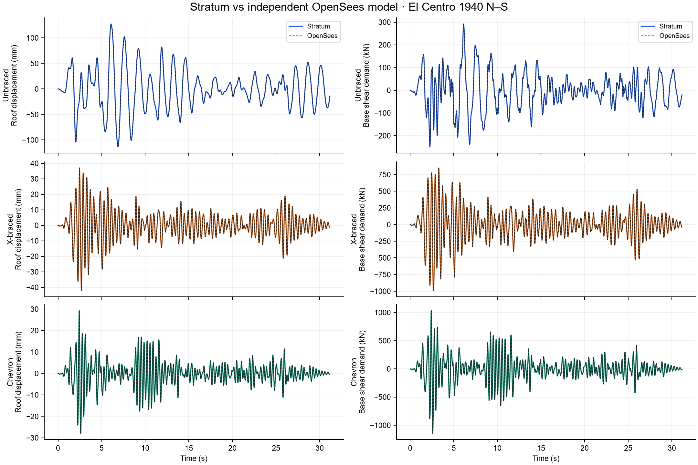

# STRATUM Seismic

**Compare elastic frame systems under the same earthquake motion.**

[](https://github.com/Valomaxed/stratum-seismic/actions/workflows/tests.yml)


An independent Python and browser workspace for unbraced, X-braced and chevron frame response, with an OpenSees verification workflow. No truss repository or machine-learning model is required.



## Capabilities

- Compare 2–8-story elastic 2D frames using identical geometry, floor masses and beam/column sections.
- Match brace steel volume between X-braced and chevron configurations.
- Read PEER-style acceleration `.AT2` files with explicit units and provenance.
- Compute periods, drift, relative roof displacement, absolute acceleration and base-shear demand.
- Animate frame translation, inspect colored comparison plots, and export JSON/CSV results.
- Check implementation against analytical solutions, an independent ODE integrator, OpenSees and time-step refinement.

## Quick start

Requires Python 3.12+. Use a source checkout so frontend assets remain beside the package.

```bash
git clone https://github.com/Valomaxed/stratum-seismic.git
cd stratum-seismic
python -m venv .venv
```

**Windows PowerShell**

```powershell
.\.venv\Scripts\python.exe -m pip install -r requirements.txt
.\.venv\Scripts\python.exe -m seismic_frame serve --host 127.0.0.1 --port 8767
```

**macOS / Linux**

```bash
.venv/bin/python -m pip install -r requirements.txt
.venv/bin/python -m seismic_frame serve --host 127.0.0.1 --port 8767
```

Open **http://127.0.0.1:8767/**. The bundled El Centro example runs by default. Adjust frame parameters or import records, then choose **Compare frames**. Changing settings marks displayed results as stale until recomputed.

## Model and comparison basis

The model assembles elastic Euler–Bernoulli beams/columns and axial braces, with fixed column bases, rigid horizontal floor translations, prescribed floor masses, and statically condensed massless vertical/rotation DOFs. Newmark average acceleration integrates the full retained floor system. Rayleigh damping targets its first two modes separately for each frame.

The same acceleration and amplitude factor are applied to every configuration. No spectrum matching, filtering, detrending or baseline correction is applied. Base-shear demand includes stiffness and damping contributions; its opposite sign represents ground-on-frame reaction. [Detailed assumptions and protocol](docs/RESEARCH.md).

## Tests

```powershell
.\.venv\Scripts\python.exe -m unittest discover -s tests -v
node --check web/seismic.js
```

The optional OpenSees-dependent tests skip when its separate interpreter is absent; analytical, ODE, report-integrity and local HTTP tests still run. Set `OPENSEES_PYTHON` to an installed reference interpreter to include those independent checks.

## Independent OpenSees verification

OpenSees is an optional reference engine in a **separate environment**, not an application dependency. The recorded reference setup uses Python 3.12 and the versions in `requirements-verification.txt`.

```powershell
py -3.12 -m venv work\opensees-venv
work\opensees-venv\Scripts\python.exe -m pip install -r requirements-verification.txt
.\.venv\Scripts\python.exe -m seismic_frame verify --opensees-python work\opensees-venv\Scripts\python.exe
```

The worker independently assembles its model from physical parameters. Verification compares modal properties, full floor histories, base shear and peaks, plus dt/dt2/dt4 convergence. Saved reports are **source-hash checked**; changed sources never retain a fresh PASS. Reports/figures are versioned; large numerical histories are regenerated locally. [Latest report](data/seismic-validation/report.md).

## Repository map

| Path | Contents |
|---|---|
| `seismic_frame/model.py` | Frame assembly, record parsing and response recovery |
| `seismic_frame/dynamics.py` | Linear Newmark average-acceleration integrator |
| `seismic_frame/server.py` | Local API and static workspace server |
| `seismic_frame/benchmark.py` | Independent comparison and convergence protocol |
| `seismic_frame/reference.py` | Separate OpenSees implementation |
| `web/` | Browser workspace and attributed example ground motion |
| `tests/` | Analytical, ODE, OpenSees, report and service checks |
| `data/seismic-validation/` | Verification reports and figures |

## Scope

Elastic implementation verification is not experimental validation or code compliance. Yielding, brace buckling, P-delta, soil interaction, 3D torsion and capacity assessment are excluded. Prescribed total floor masses include all assigned mass; member self-mass is not added separately. The bundled El Centro record is one attributed example, not a hazard-selected earthquake suite. [Record provenance](web/records/README.md).

## Related project and contributions

Truss/bridge FEM, sensing and damage estimation live in **[STRATUM](https://github.com/Valomaxed/stratum)**.

[Architecture](docs/ARCHITECTURE.md) · [Research](docs/RESEARCH.md) · [Migration](docs/REPOSITORY_SPLIT.md) · [Changelog](CHANGELOG.md) · [Contributing](CONTRIBUTING.md) · [Issues](https://github.com/Valomaxed/stratum-seismic/issues)
