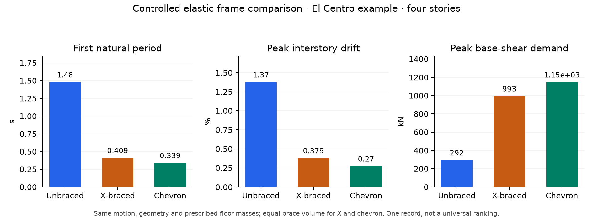

# STRATUM Seismic

**Controlled elastic frame comparison with independent numerical verification**

**Author: [Atharv Sharma](AUTHORS.md)** · Research software portfolio

[](https://github.com/Valomaxed/stratum-seismic/actions/workflows/tests.yml)

**Academic review:** [Start here](START_HERE.md) · [Results](docs/RESULTS.md) · [Reproduce](docs/REPRODUCIBILITY.md) · [Architecture](docs/ARCHITECTURE.md)

Private repository: arrange access before sharing the CV link. [Reviewer access](docs/REVIEWER_ACCESS.md).

## Research question

How do unbraced, X-braced and chevron frames change elastic drift and base-shear demand under controlled common excitation, and how can the implementation be independently verified?

This project implements a Python frame solver and browser comparison. Geometry, beam/column sections and prescribed floor masses are held constant. X and chevron layouts use equal brace steel volume. A separate OpenSees worker supplies independent implementation checks.

## Implemented work

| Component | Implementation and review evidence |
|---|---|
| Frame mechanics | [Beam-column/brace assembly and condensation](seismic_frame/model.py), fixed bases and floor translation constraints |
| Dynamics | [Newmark average acceleration](seismic_frame/dynamics.py), Rayleigh damping and response recovery |
| Excitation handling | AT2 count/time-step/unit checks, explicit scaling and [record provenance](web/records/README.md) |
| Verification | [Analytical/ODE tests](tests/test_model.py), [independent OpenSees model](seismic_frame/reference.py), [comparison and refinement protocol](seismic_frame/benchmark.py) |
| Interface | [Frame playback, colored plots and JSON/CSV exports](web/seismic.js) |

NumPy/SciPy provide linear algebra. Assembly, reduction, record handling, response calculation and comparison are implemented in this repository. The production solver runs without OpenSees. [Suggested source review route](START_HERE.md).

## Example result and interpretation

Four stories; common El Centro example (PGA 0.31882 g); factor 1.0; 5% target damping:

| System | First period (s) | Peak drift (%) | Peak roof displacement (mm) | Peak base-shear demand (kN) |
|---|---:|---:|---:|---:|
| Unbraced | 1.475 | 1.373 | 127.25 | 291.7 |
| X-braced | 0.409 | 0.379 | 42.21 | 993.0 |
| Chevron | 0.339 | 0.270 | 29.24 | 1145.0 |



For this record and elastic model, bracing reduces computed drift while increasing peak base-shear demand. Displacement and force demands must be examined together. This example does not establish a universal ranking of brace systems. [Settings, response definitions and interpretation](docs/RESULTS.md).

## Independent verification at a glance

The saved benchmark passes **9/9 case/system comparisons** and **3/3 time-step studies**. Full floor histories, modes, shear, peaks and support/damping balance are checked. Floor-history refinement ratios are approximately four.

[Verification report](data/seismic-validation/report.md) · [Machine-readable evidence](data/seismic-validation/report.json) · [Reproduction instructions](docs/REPRODUCIBILITY.md)

This verifies the stated elastic implementation. A numerical-source or record change invalidates the report's fresh PASS. Physical validation and omitted nonlinear mechanisms remain separate work.

## Fast numerical review

After installing requirements.txt, run from the repository root:

```bash
python examples/quick_review.py
```

This recomputes the example table with the production solver. [Recorded output](data/review-example.json). No ML model, server or OpenSees installation is required.

## Quick start

Requires Python 3.12+. Use a source checkout so frontend assets remain beside the package.

```bash
git clone https://github.com/Valomaxed/stratum-seismic.git
cd stratum-seismic
python -m venv .venv
```

**Windows PowerShell**

```powershell
.\.venv\Scripts\python.exe -m pip install -r requirements.txt
.\.venv\Scripts\python.exe -m seismic_frame serve --host 127.0.0.1 --port 8767
```

**macOS / Linux**

```bash
.venv/bin/python -m pip install -r requirements.txt
.venv/bin/python -m seismic_frame serve --host 127.0.0.1 --port 8767
```

Open **http://127.0.0.1:8767/**. The bundled El Centro example runs by default. Adjust frame parameters or import records, then choose **Compare frames**. Changing settings marks displayed results as stale until recomputed.

## Tests

```powershell
.\.venv\Scripts\python.exe -m unittest discover -s tests -v
node --check web/seismic.js
```

The optional OpenSees-dependent tests skip when its separate interpreter is absent; analytical, ODE, report-integrity and local HTTP tests still run. Set `OPENSEES_PYTHON` to an installed reference interpreter to include those independent checks.

## Independent OpenSees verification

OpenSees is an optional reference engine in a **separate environment**, not an application dependency. The recorded reference setup uses Python 3.12 and the versions in `requirements-verification.txt`.

```powershell
py -3.12 -m venv work\opensees-venv
work\opensees-venv\Scripts\python.exe -m pip install -r requirements-verification.txt
.\.venv\Scripts\python.exe -m seismic_frame verify --opensees-python work\opensees-venv\Scripts\python.exe
```

The worker independently assembles its model from physical parameters. Verification compares modal properties, full floor histories, base shear and peaks, plus dt/dt2/dt4 convergence. Saved reports are **source-hash checked**; changed sources never retain a fresh PASS. Reports/figures are versioned; large numerical histories are regenerated locally. [Latest report](data/seismic-validation/report.md).

## Repository map

| Path | Contents |
|---|---|
| `seismic_frame/model.py` | Frame assembly, record parsing and response recovery |
| `seismic_frame/dynamics.py` | Linear Newmark average-acceleration integrator |
| `seismic_frame/server.py` | Local API and static workspace server |
| `seismic_frame/benchmark.py` | Independent comparison and convergence protocol |
| `seismic_frame/reference.py` | Separate OpenSees implementation |
| `web/` | Browser workspace and attributed example ground motion |
| `tests/` | Analytical, ODE, OpenSees, report and service checks |
| `data/seismic-validation/` | Verification reports and figures |

## Scope

Elastic implementation verification is not experimental validation or code compliance. Yielding, brace buckling, P-delta, soil interaction, 3D torsion and capacity assessment are excluded. Prescribed total floor masses include all assigned mass; member self-mass is not added separately. The bundled El Centro record is one attributed example, not a hazard-selected earthquake suite. [Record provenance](web/records/README.md).

## Related project and contributions

Truss/bridge FEM, sensing and damage estimation live in **[STRATUM](https://github.com/Valomaxed/stratum)**.

[Academic review](START_HERE.md) · [Results](docs/RESULTS.md) · [Reproduce](docs/REPRODUCIBILITY.md) · [Authorship](AUTHORS.md) · [Citation](CITATION.cff) · [Architecture](docs/ARCHITECTURE.md) · [Research](docs/RESEARCH.md) · [Migration](docs/REPOSITORY_SPLIT.md) · [Changelog](CHANGELOG.md) · [Contributing](CONTRIBUTING.md) · [Issues](https://github.com/Valomaxed/stratum-seismic/issues)
